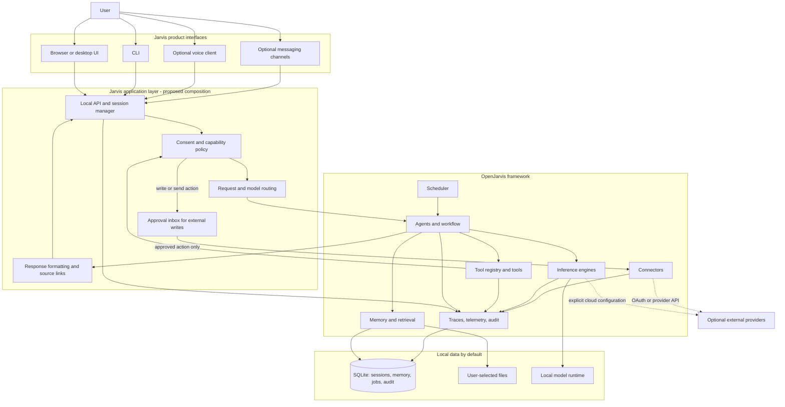

# Jarvis feature recommendations and architecture

**Status:** proposed product design for this workspace. OpenJarvis already provides the framework primitives described below; the product features and wiring in this document are recommendations, not claims that a finished Jarvis application has already been implemented.

## Recommendation

Build Jarvis as a local-first personal assistant on top of OpenJarvis. Start with a reliable desktop/browser chat, local document search with source links, and explicit memory controls. Add speech, messaging, Google services, and scheduled routines in later phases, each opt-in and scoped to the user's chosen data.

This order gives a useful assistant before it has access to email, calendar, or shell actions. The repository already includes pluggable engines, agents, tools, memory, traces, telemetry, security, channels, and scheduling. The main product work is to compose these capabilities into a clear UI and enforce consistent consent and action policies across them.

## Feature roadmap

| Priority | Feature | User value | Building blocks already in OpenJarvis | Product work / guardrail |
|---|---|---|---|---|
| P0 | Local chat and setup wizard | Get started without API keys | CLI, `chat-simple` agent, hardware detection, Ollama engine | Guided status/errors; keep cloud disabled by default |
| P0 | Personal knowledge vault | Ask questions about selected files | Memory ingestion, SQLite/FTS5, retrieval, context attribution | Show source snippets; allow per-folder indexing and deletion |
| P0 | Conversation history and memory controls | Resume work and control retained data | Sessions, memory, traces | Separate chat history from long-term memory; clear/export controls |
| P1 | Voice input and spoken replies | Hands-free use | Speech and digest components | Push-to-talk first; show when a hosted voice provider is used |
| P1 | Daily briefing | Summarize calendar, tasks, and selected email | Google connector, agents, scheduler, TTS | Read-only scopes by default; preview data sources; no sending or editing |
| P1 | Action approval inbox | Review proposed changes before they happen | Agent/tool execution, security audit, scheduler | New product layer: classify tools by risk and require confirmation for external writes |
| P2 | Messaging entry points | Reach Jarvis from an existing chat app | Channel registry and channel implementations | Pairing allowlist, sender authorization, rate limits, unlink control |
| P2 | Routines and reminders | Automate repeatable personal workflows | Scheduler, operative agents, traces | Dry-run preview, pause/disable controls, run history, bounded retries |
| P2 | Privacy and activity dashboard | Understand where data went and what ran | Telemetry, traces, security audit | Unified timeline with local/cloud destination and retention controls |

### Suggested first milestone

Deliver P0 only: local chat, optional local-file indexing, grounded answers with source locations, and simple delete/export controls. Do not connect Gmail or enable autonomous write actions in the first milestone. This keeps the first version testable and useful while limiting data exposure.

## Proposed architecture

### Component responsibilities

- **Interfaces:** collect user input, display replies and source links, and expose consent and approval controls. They should not hold provider secrets or implement agent policy.
- **Local API and session manager:** authenticate local clients where needed, associate requests with a session, and call the OpenJarvis SDK/server. Bind to localhost by default; remote access should require deliberate configuration.
- **Consent and capability policy (proposed):** apply one policy to UI, CLI, channels, and scheduled runs. Distinguish read-only retrieval from external side effects such as sending, editing, deleting, or executing commands.
- **Approval inbox (proposed):** pause side-effecting operations, show the exact action and target, and continue only after an explicit approval. Scheduled and messaging runs should not silently inherit interactive approval.
- **Agent and tool runtime:** use OpenJarvis agents for response planning and its registry-based tools for bounded capabilities. Avoid granting general shell or filesystem access to the default assistant.
- **Memory and retrieval:** index only user-selected sources; return provenance with retrieved passages. Keep short-lived conversation state separate from persistent knowledge and traces.
- **Engine and routing:** prefer a local backend. Cloud inference is an explicit per-profile choice and must be visible in the interface before sensitive content is sent.
- **Connectors and channels:** isolate provider credentials and OAuth tokens, use the narrowest available scopes, and provide disconnect/revoke controls.
- **Scheduler:** run only named, reviewable routines. Persist next-run time, last result, approval state, and a pause/disable switch.
- **Trace, telemetry, and audit:** keep operational history local by default. Provide retention settings and redact secrets; avoid recording full message bodies unless the user opts in.

## Request flow

1. The interface submits a request to the local API with a session identifier and selected profile.
2. Policy resolves permitted data sources, tools, model destination, and whether user approval is needed.
3. The router selects the configured agent and engine. Memory retrieval, if enabled, returns passages with source identifiers.
4. The agent produces an answer or proposes a tool call. Read-only calls run within the configured scope; external writes pause for approval.
5. The response is returned with source references and a clear local/cloud indicator. A trace records operational metadata subject to retention settings.

## Data and trust boundaries

| Boundary | Default | Required control |
|---|---|---|
| User device to local Jarvis | Localhost / local files | Bind locally; use file allowlists and sensitive-file filtering |
| Jarvis to local model | Local runtime | Display active engine and model |
| Jarvis to cloud model or TTS | Off until configured | Per-feature opt-in, provider disclosure, usage-limit notice |
| Jarvis to Google or chat platform | Off until connected | OAuth scope review, account disconnect, token storage protection |
| Agent to tools that change state | Approval required (proposed policy) | Show action, target, and data before approval; audit result |
| Scheduled task to tools | Disabled until configured | Dry run, bounded permissions, pause switch, run log |

## Delivery sequence

1. **Foundation:** local setup screen, local chat, engine health, model status, session history.
2. **Knowledge:** file allowlist, indexing status, retrieval with source links, remove/re-index controls.
3. **Safety and control:** capability policy, approval inbox, activity timeline, export/delete controls.
4. **Voice and briefings:** push-to-talk and spoken responses; then opt-in read-only calendar/email briefing.
5. **Automation and channels:** scheduled routines and messaging after per-sender authorization, approval handling, and pause controls exist.

## Existing framework reference

The upstream architecture describes five central primitives: Intelligence, Engine, Agentic Logic, Memory, and Learning. Its source also contains modules for sessions, tools, connectors, channels, speech, scheduler, security, traces, telemetry, and server. This design treats the consent policy, approval inbox, user-facing setup, and unified privacy/activity views as product-level work to define and integrate rather than assuming they already exist as one end-to-end feature.

Useful local references:

- `docs/architecture/overview.md`
- `docs/architecture/query-flow.md`
- `docs/architecture/security.md`
- `docs/architecture/memory.md`
- `docs/architecture/channels.md`
- `JARVIS-START-HERE.md`
